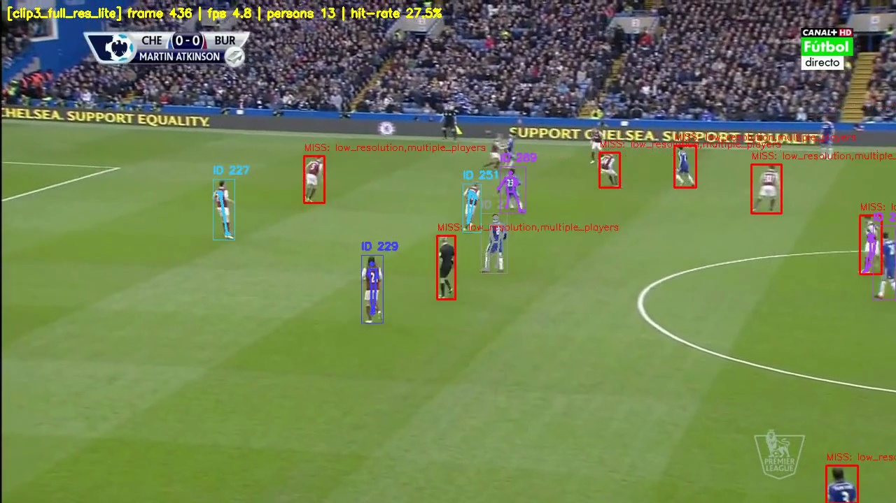
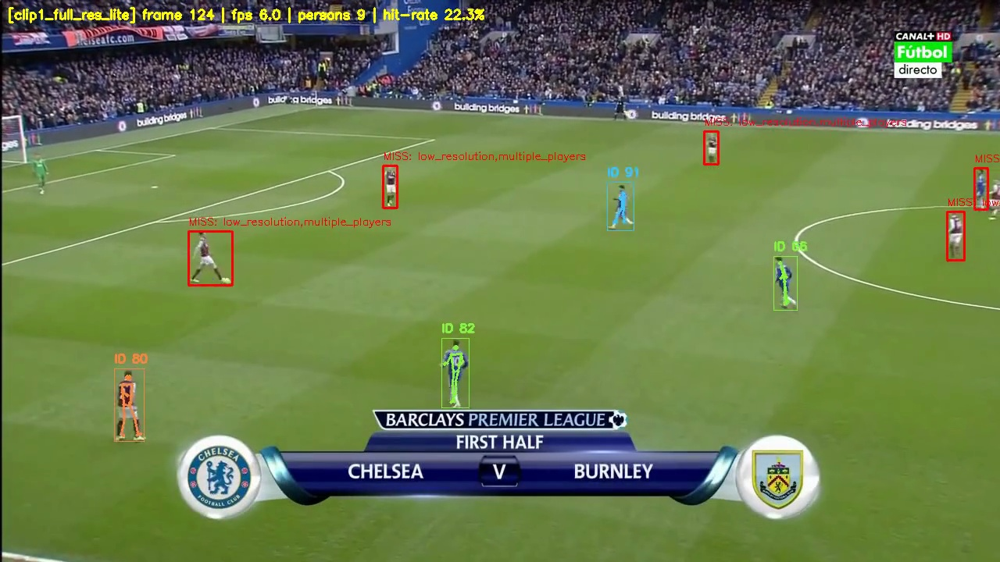
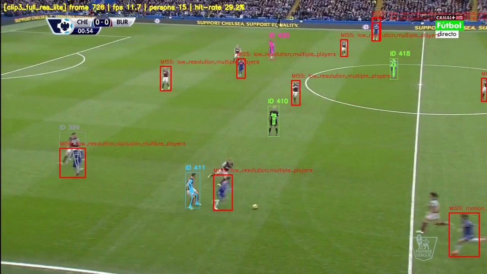
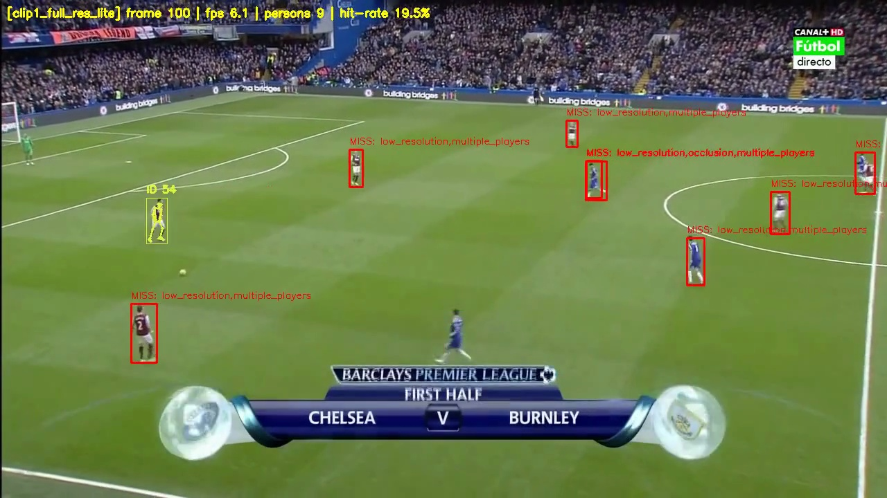
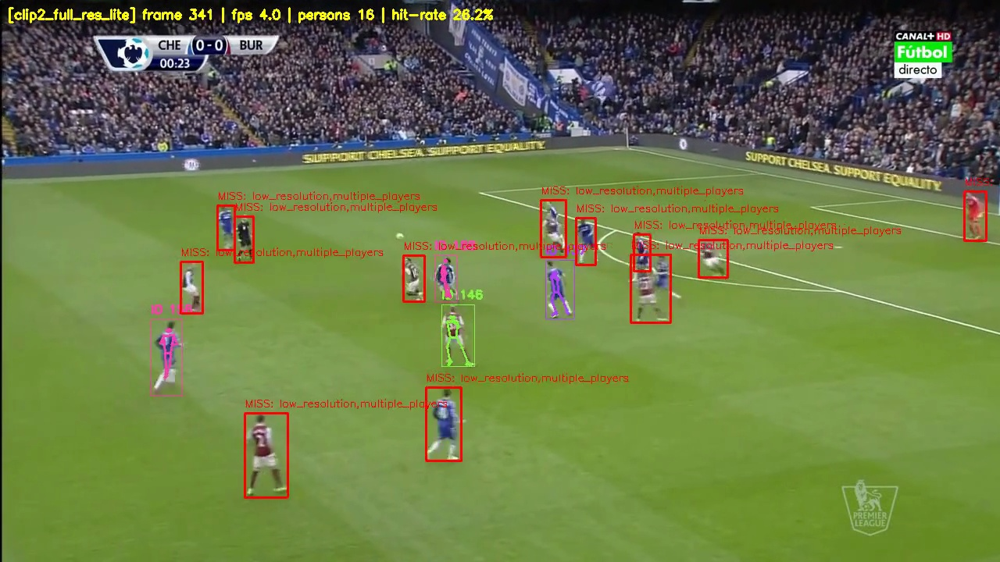

# Multi-Player Pose Estimation on Football Broadcast Video

Tracking the skeletons of several football players at once on real match footage, comparing lightweight and heavier pose models, and finding out **why** pose estimation fails on broadcast video.

Built in Python at the University of Messina (Nov 2025 – Feb 2026), using YOLOv8, MediaPipe Pose and OpenCV, with an interactive Streamlit dashboard to explore the results.



---

## What it does

- Takes broadcast football video (SoccerNet match clips) or a webcam
- Finds every player in each frame with a **YOLOv8** person detector
- Estimates a **33-point skeleton** for each player with **MediaPipe Pose**
- Follows each player across frames with a simple IoU tracker, so every skeleton keeps the same ID
- Smooths the joints over time with a **One Euro filter** to reduce jitter
- When the pose model misses a player, guesses the reason: low resolution, motion blur, occlusion or crowding
- Saves annotated videos, per-frame logs and summary CSVs, and shows them in a **Streamlit dashboard**

## Why it's interesting

Pose models are usually shown on one person, close to the camera, in good light. Broadcast football is the opposite: many small players, fast motion and constant overlap. This project measures how well standard models hold up in that setting, and where and why they break.

---

## How it works

```
Video  ->  YOLOv8 person detection  ->  crop each player  ->  MediaPipe Pose (33 landmarks)
                                                                      |
Streamlit dashboard  <-  CSV logs + annotated video  <-  IoU tracking + One Euro smoothing
                                                                      |
                                                         miss-cause analysis
```

1. **Detection:** YOLOv8n finds every person in the frame.
2. **Pose:** each player crop goes through MediaPipe Pose (lite, full or heavy model).
3. **Tracking:** an IoU tracker keeps a stable ID for each player between frames.
4. **Smoothing:** a One Euro filter reduces frame-to-frame jitter in the joint positions.
5. **Failure analysis:** for each missed pose, the code checks the box size (low resolution), image sharpness with the Laplacian (motion blur), overlap with other boxes (occlusion) and the number of nearby players (crowding).
6. **Dashboard:** `app.py` lets you replay any run with the skeleton overlay, plot a joint over time and read the tracking-quality statistics.

---

## Results

### Model comparison (125 frames of match footage)

| Model | Speed (FPS) | Players detected | Poses found | Miss rate | Avg. keypoint confidence |
|---|---|---|---|---|---|
| MediaPipe lite | 2.99 | 1,808 | 1,528 | 15.5% | 0.77 |
| MediaPipe full | 2.22 | 1,808 | 1,396 | 22.8% | 0.80 |
| MediaPipe heavy | 0.73 | 1,808 | 1,201 | 33.6% | 0.73 |
| YOLOv8n-pose | 13.75 | 117 | 117 | 0.0% | 0.70 |

### Effect of input resolution (MediaPipe full)

| Scale | Speed (FPS) | Miss rate | Avg. keypoint confidence |
|---|---|---|---|
| 1.0 (full) | 2.37 | 22.8% | 0.80 |
| 0.75 | 2.42 | 24.6% | 0.80 |
| 0.5 | 2.50 | 33.5% | 0.80 |

### What I found

- **The lightest MediaPipe model worked best here.** On small, distant players, the lite model missed the fewest poses (15.5%), while the heavy model was 4x slower and missed more than twice as many (33.6%).
- **YOLOv8n-pose was the fastest by far (13.75 FPS),** but it found only 117 players across the same 125 frames, against 1,808 for the YOLOv8 detector. Its 0% miss rate looks perfect only because it skips most of the hard, small players, so it isn't a fair like-for-like win.
- **Lowering the resolution barely saved time but cost accuracy.** Halving the input size raised the miss rate from 22.8% to 33.5% for almost no speed gain, because most of the time is spent running the pose model on each player, not on the full frame.
- **Small players are the main problem.** Low resolution, motion blur, occlusion and crowding are the four causes the analysis looks for. Example frames for each are below.

All numbers come from `comparison_results.csv` and `resolution_results.csv` in this repo.

### Failure cases

| Low resolution | Motion blur |
|---|---|
|  |  |

| Occlusion | Multiple players |
|---|---|
|  |  |

---

## Tech stack

| Area | Tools |
|---|---|
| Language | Python |
| Person detection | YOLOv8 (Ultralytics) |
| Pose estimation | MediaPipe Pose, YOLOv8n-pose |
| Video and image processing | OpenCV, ffmpeg |
| Data and plots | NumPy, Pandas, Matplotlib |
| Dashboard | Streamlit |
| Data | SoccerNet broadcast match footage |

---

## Getting started

### Install

```bash
git clone https://github.com/Aman7156/Pose-estimation---Computer-vision.git
cd Pose-estimation---Computer-vision
pip install opencv-python mediapipe ultralytics numpy pandas matplotlib streamlit
```

### Run the model comparison

```bash
# MediaPipe lite model on a clip, with a miss-cause plot
python compare_pose_models.py --source clip1.mp4 --model-complexity 0 --run-name mediapipe_lite --plot

# Same clip at half resolution
python compare_pose_models.py --source clip1.mp4 --model-complexity 1 --resize-scale 0.5 --run-name mediapipe_full_scale_0.5

# Live from a webcam
python compare_pose_models.py --source 0
```

Each run saves an annotated video and a per-frame log in `phase3_outputs/`, and adds one summary row to `comparison_results.csv`.

### Open the dashboard

```bash
streamlit run app.py
```

If a video won't play in the browser, re-encode it to H.264 with `bash reencode_videos.sh`.

---

## Project structure

| File | What it does |
|---|---|
| `pose_pipeline.py` | First version: YOLOv8 detection + MediaPipe pose per player |
| `pose_pipeline_improved.py` | Improved pipeline with tracking and smoothing |
| `compare_pose_models.py` | Main experiment: model and resolution comparison, failure-cause analysis |
| `extract_frames.py` | Picks example frames for each hit and miss type |
| `HCI_pose.py` | Pose tracking with a centroid tracker, used for the dashboard demo |
| `app.py` | Streamlit dashboard |
| `mediapipe_only.py` | MediaPipe-only baseline |
| `reencode_videos.sh` | Converts output videos to H.264 for the browser |
| `*.csv` | Results, keypoints and statistics |

---

## Limitations and next steps

- Speed is far from real time on this setup: 0.7 to 3 FPS for MediaPipe on many players, 13.75 FPS for YOLOv8n-pose. Batching player crops or running on a GPU would be the next step.
- The miss causes are estimated with simple rules (box size, sharpness, overlap), not hand-labelled ground truth.
- Accuracy is measured with keypoint confidence and miss rate, not against labelled poses.

---

## What I learned

- A bigger model is not automatically better: on small, distant players the lightest model won.
- Measuring *why* a model fails is as useful as measuring how often.
- Building a dashboard makes results understandable for people who don't read CSV files.

---

## Data

Match footage comes from the [SoccerNet](https://www.soccer-net.org/) dataset and is used for research only, under the SoccerNet terms.

## Author

**Aman Kumar Singh**  
M.Sc. Data Science and Engineering, Politecnico di Torino  
[LinkedIn](https://linkedin.com/in/aman-kumar-singh-4a632a1a0) · [GitHub](https://github.com/Aman7156)
